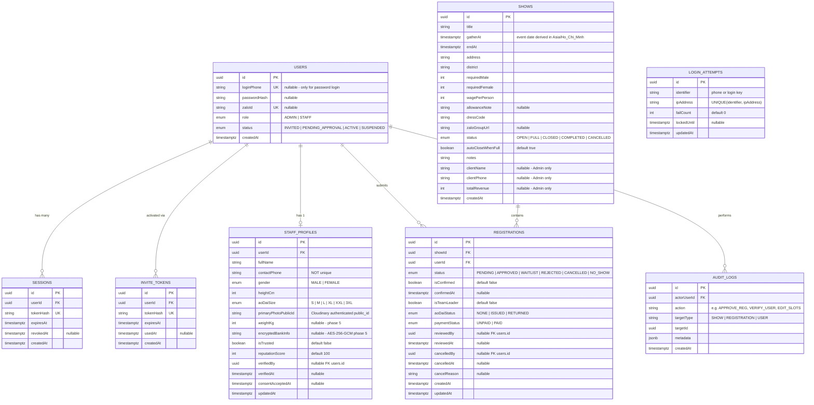

# Kế hoạch Tổng thể: Hệ thống Quản lý Nhân sự Bưng Quả Đám Cưới — Hoài Thương Wedding (v7)

> **Cập nhật v7 (Chốt Hạ tầng Thực tế & Vá Luật Nghiệp vụ)**:
> 1. **Bảo vệ ảnh qua `/api/photos/[staffId]`**: Vì Cloudinary Free không có token-based URL tự hết hạn, mọi ảnh hồ sơ (`type: 'authenticated'`) sẽ đi qua route `/api/photos/[staffId]` có kiểm tra `requireUser()`/`requireAdmin()` rồi mới trả ảnh (kèm `Cache-Control: private`).
> 2. **Hạ tầng Render Starter + Neon Singapore & Tách 2 URL kết nối**:
>    - Chọn **Region Singapore** cho cả **Render** và **Neon** để giảm độ trễ về Việt Nam; dùng **Render Starter (\$7/tháng, không tự ngủ)** cho cả Staging có test Zalo và Production (tránh lỗi ngủ 15 phút làm timeout bot Open Graph của Zalo); kiểm tra mức RAM 512 MB khi build/run.
>    - Tách 2 biến môi trường: `DATABASE_URL` (Neon **Pooled** `-pooler` với `pg.Pool({ max: 5 })` + gắn `pool.on('error')`, không dùng `SET`/`LISTEN`/session advisory locks) cho ứng dụng, và `DATABASE_URL_UNPOOLED` (Neon **Direct**) cho `drizzle-kit` migration & `pg_dump`.
> 3. **Vá 5 lỗ hổng luật nghiệp vụ**:
>    - **Xác minh danh tính tách bạch**: Khi duyệt nhân sự đang `PENDING_APPROVAL` vào show, hiển thị Tên Zalo + SĐT + Ảnh cạnh nhau và bắt buộc Admin tick **"Đã xác minh danh tính & Duyệt"**, lưu `verifiedBy` & `verifiedAt`.
>    - **Ưu tiên Waitlist khi có người hủy trước 24h**: Khi 1 nhân sự `APPROVED` tự hủy trước `gatherAt` ≥ 24h trên show đang `FULL`, nếu đang có người cùng giới tính trong **`WAITLIST`** thì **không** mở công khai `OPEN` (tránh người mới chen ngang) mà báo Admin đẩy người từ `WAITLIST` lên; chỉ tự mở `OPEN` khi `WAITLIST` của giới tính đó trống.
>    - **Khóa dòng `shows` (`FOR UPDATE`) trên cả 5 đường làm đổi slot**: (1) Duyệt `APPROVED`, (2) Hạ/bỏ duyệt người đã `APPROVED`, (3) Nhân sự `APPROVED` tự hủy trước 24h, (4) Admin sửa `requiredMale`/`requiredFemale` (không cho giảm thấp hơn số đã `APPROVED`), (5) Đánh dấu vắng mặt (`NO_SHOW`).
>    - **Rate Limit 2 tầng trên `login_attempts`**: Ràng buộc `UNIQUE(identifier, ipAddress)` để upsert theo cặp `(identifier, ip)`, kết hợp **ngưỡng tổng theo `identifier`** (progressive delay làm chậm khi bị dò từ nhiều IP mà không khóa cứng gây DoS tài khoản thật).
>    - **Truy vết & Nhật ký (`audit_logs`)**: Thêm `reviewedBy`, `reviewedAt`, `cancelledBy`, `cancelledAt`, `cancelReason` trên `registrations` và bảng **`audit_logs`** (tổng cộng 8 bảng).
> 4. **Chuẩn hóa dữ liệu & Tiêu chí Pass/Fail cho Spike Zalo**: Bỏ cột `eventDate` dư thừa (suy ra từ `gatherAt` theo `Asia/Ho_Chi_Minh`); xóa sạch ảnh Cloudinary + thu hồi `sessions` khi xóa/ẩn danh tài khoản (giữ lại bản ghi đối soát lương); chốt rõ tiêu chí Đạt/Không đạt cho Phase 0A trước khi chạy.

---

# PHẦN 1: PHÂN TÍCH NGHIỆP VỤ & KIẾN TRÚC CHUẨN

## 1.1. Luồng vận hành End-to-End (Chốt v7)
1. **Hồ sơ & Danh tính (0đ, chống giả mạo SĐT)**:
   - **Đường 1 (Tự đăng nhập Zalo từ group chung)**: Nhân sự bấm **Đăng nhập bằng Zalo** → điền 6 trường tối thiểu (Họ tên, SĐT liên hệ, Giới tính, Chiều cao, Size áo dài `S..3XL`, 1 ảnh) + tick đồng ý NĐ 356/2025 → trạng thái **`PENDING_APPROVAL`** (vẫn được đăng ký show ngay).
   - **Đường 2 (Admin mời trực tiếp)**: Admin nhập Tên + SĐT → gửi **Link kích hoạt 1 lần (`invite_tokens`)** qua Zalo cá nhân → nhân sự liên kết Zalo (hoặc đặt mật khẩu) → trạng thái **`ACTIVE`** ngay (đã được Admin xác minh từ đầu).
   - SĐT liên hệ (`contactPhone`) **không** đặt `UNIQUE`.
2. **Mở tuyển & Đăng ký 1 chạm**:
   - Admin tạo show (Slot Nam/Nữ riêng, `gatherAt`/`endAt` dạng `timestamptz`, địa chỉ, quận, `wagePerPerson`, `allowanceNote`, `dressCode`, `zaloGroupUrl`) → bấm **Copy tin tuyển show** dán vào group chung. Ngày diễn ra được suy trực tiếp từ `gatherAt` theo múi giờ `Asia/Ho_Chi_Minh`.
   - Trang `/shows/[id]` **công khai** phần thông tin tuyển dụng (ẩn thông tin khách & danh sách nhân sự) để bot Zalo lấy thẻ Open Graph.
   - Nhân sự bấm **Đăng ký ngay (1 chạm)**: kiểm tra đúng giới tính còn mở; nếu trước đó đã hủy thì dùng **upsert** đổi trạng thái lại thành `PENDING`.
3. **Quy tắc Hủy đăng ký 24h & Bảo vệ hàng đợi Dự bị (Waitlist)**:
   - Nhân sự tự hủy tự do khi đang `PENDING` hoặc `WAITLIST`.
   - Khi đã `APPROVED`, chỉ cho tự hủy **trước `gatherAt` ≥ 24 tiếng** (dưới 24h khóa nút tự hủy, bắt nhắn trực tiếp Admin).
   - Khi một nhân sự `APPROVED` hủy hợp lệ (chạy trong transaction khóa dòng `shows`):
     - Nếu show đang có ứng viên cùng giới tính ở trạng thái **`WAITLIST`**: **Không** mở lại `OPEN` công khai (tránh người mới chen hàng); giữ trạng thái đóng với bên ngoài và hiển thị cảnh báo **"Có chỗ trống — Chờ đôn Dự bị"** để Admin duyệt người từ `WAITLIST` lên.
     - Chỉ khi **không có ai cùng giới tính trong `WAITLIST`** thì show mới tự động chuyển về `OPEN`.
4. **Duyệt nhanh, Xác minh danh tính & Khóa Slot trên mọi đường**:
   - Trên danh sách ứng viên của show, hệ thống hiển thị:
     - Nhãn **"Nhân sự mới chờ xác minh"** (nếu `users.status === 'PENDING_APPROVAL'`) kèm Tên Zalo, SĐT liên hệ và Ảnh đặt cạnh nhau → Admin phải tick **"Đã xác minh danh tính"** khi bấm Duyệt (lưu `verifiedBy`, `verifiedAt` và nâng lên `ACTIVE`).
     - **Nhãn cảnh báo đỏ** nếu trùng khung giờ `[gatherAt, endAt]` hoặc vi phạm **khoảng đệm di chuyển 60 phút** với show khác trong ngày.
   - Mọi thao tác làm thay đổi slot (`PENDING/WAITLIST -> APPROVED`, hạ duyệt `APPROVED -> WAITLIST/REJECTED`, nhân sự `APPROVED` tự hủy, Admin sửa `requiredMale`/`requiredFemale`, đánh dấu vắng mặt `NO_SHOW`) đều bắt buộc đi qua hàm dùng chung `withLockedShow(tx, showId)` (`SELECT ... FROM shows WHERE id = $1 FOR UPDATE`) và ghi vào **`audit_logs`**.
5. **Xác nhận & Cầu nối Zalo ngày show**:
   - Nhân sự đã duyệt bấm **Xác nhận đi show (Confirm)** và bấm **Vào group Zalo show** (chỉ trả về cho user đã `APPROVED`).
   - Admin xem bảng **Thống kê Size áo dài (`S..3XL`)** tự động theo Nam/Nữ, lọc **"Ai chưa Confirm"** và bấm **Xuất danh sách đã duyệt** dán vào group Zalo riêng của show.

## 1.2. Hạ tầng, Bảo mật & Chi phí Vận hành
- **Framework**: **Next.js 16 (App Router)** + **TypeScript (strict)** — tách lớp nghiệp vụ trong **`src/server/` (`dal/`, `services/`, `repositories/`)**; dùng **`proxy.ts`** chỉ để redirect nhanh và bắt buộc gọi `requireUser()` / `requireAdmin()` ở đầu mọi hàm DAL, mọi Server Action và route `/api/photos/[staffId]`.
- **Database & Kết nối Neon**:
  - Region: **Singapore (`aws-ap-southeast-1`)**.
  - `DATABASE_URL` (Pooled `-pooler`, PgBouncer transaction mode): Dùng cho runtime với `pg.Pool({ max: 5, idleTimeoutMillis: 30000 })` + `pool.on('error', ...)` để tự phục hồi khi Neon wake-up. Tuyệt đối không dùng `SET` theo phiên, `LISTEN/NOTIFY` hay session-level advisory locks.
  - `DATABASE_URL_UNPOOLED` (Direct): Dùng riêng cho `drizzle-kit` migrations và `pg_dump`.
- **Hosting trên Render**:
  - Region: **Singapore**.
  - Dùng gói **Render Starter (\$7/tháng, không spin-down)** cho cả Staging (khi test Zalo) và Production; theo dõi mức RAM (512 MB) khi chạy `next start`.
  - Chi phí vận hành ước tính: **Render Starter (\$7) + Neon Launch (~\$2.5 khi bật scale-to-zero hoặc ~\$19 khi chạy 0.25 CU liên tục) ≈ \$9.5 – \$26/tháng**.
- **Bảo vệ Ảnh & Dữ liệu cá nhân (NĐ 356/2025/NĐ-CP)**:
  - Upload ảnh lên **Cloudinary** với `type: 'authenticated'`. Trình duyệt chỉ tải ảnh qua route nội bộ **`GET /api/photos/[staffId]`** (xác thực quyền trong DB trước khi fetch/stream từ Cloudinary kèm `Cache-Control: private, max-age=3600`).
  - Khi người dùng yêu cầu **Xóa/Ẩn danh tài khoản**: gọi Cloudinary API xóa vĩnh viễn ảnh (`primaryPhotoPublicId`), thu hồi toàn bộ `sessions`, xóa thông tin định danh trên `users`/`staff_profiles`, chỉ giữ lại bản ghi lịch sử tham gia/thanh toán đã ẩn danh phục vụ đối soát kế toán.

## 1.3. Database Schema (8 bảng cốt lõi)

---

# PHẦN 2: SETUP BASECODE & SPIKE KỸ THUẬT (PHASE 0)

## Phase 0A: Spike Zalo Login (1–2 giờ — Làm TRƯỚC khi chốt schema DB)
1. Khởi tạo khung Next.js 16 (App Router, TypeScript strict, Tailwind CSS, ESLint, Prettier) + tự động gắn thẻ xác thực Zalo (`zalo-platform-site-verification`) từ env trong `layout.tsx` và file xác thực HTML trong `public/`.
2. Dựng trang test tối thiểu `/zalo-spike` + 3 route `/api/auth/zalo`, `/api/auth/zalo/callback`, `/api/auth/zalo/logout` (PKCE + `secret_key` + `/v2.0/me` theo [zalo-docs.md](../zalo-docs.md)) + `/api/health`.
3. Deploy trực tiếp qua **GitHub → Render Free (Region Singapore)** (`https://hoai-thuong-wedding.onrender.com`), xác minh tiền tố URL trên `developers.zalo.me`, test trực tiếp trên **iPhone & Android trong Zalo WebView**. *(Sau này khi tăng số lượng nhân sự/show, chỉ cần bật gói Render Starter $7/tháng + Neon Launch mà không phải đổi code.)*
4. **Tiêu chí Đạt / Không đạt (Go / No-Go Criteria) chốt trước khi chạy**:
   - **ĐẠT (Dùng Zalo Login làm chính ngay ở MVP)**: Tài khoản Zalo thông thường (ngoài danh sách Tester) đăng nhập được khi bật app Đang hoạt động mà không vướng thủ tục giấy phép phức tạp, và cookie `HttpOnly` giữ được phiên trong Zalo WebView.
   - **KHÔNG ĐẠT (Chuyển ngay sang phương án dự phòng không chờ đợi)**: Nếu Zalo chặn người ngoài Tester (đòi thẩm định doanh nghiệp lâu) hoặc WebView xóa cookie liên tục → tạm tắt nút Zalo Login ở MVP, ra mắt ngay bằng luồng **Link kích hoạt 1 lần qua Zalo cá nhân + SĐT/Mật khẩu** (cấu trúc DB giữ nguyên cột `zaloId` chờ bật lại sau).

## Phase 0B: Chốt Basecode, Database (2 URL Neon) & Tầng Bảo mật (DAL)
1. Cài đặt **shadcn/ui**, **Lucide Icons**, **React Hook Form**, **Zod**, **bcryptjs**, **cloudinary** và cấu hình hệ màu [docs-1.md](../docs-1.md).
2. Cấu hình **Drizzle ORM** với 2 biến môi trường:
   - `DATABASE_URL` (Neon Pooled `-pooler`) dùng với `pg.Pool({ max: 5, idleTimeoutMillis: 30000 })` + gắn `pool.on('error', ...)` cho runtime app.
   - `DATABASE_URL_UNPOOLED` (Neon Direct) cấu hình trong `drizzle.config.ts` cho migrations & `pg_dump`.
3. Viết đầy đủ **8 bảng** (`users`, `sessions`, `login_attempts`, `invite_tokens`, `staff_profiles`, `shows`, `registrations`, `audit_logs`), ràng buộc `UNIQUE(show_id, user_id)` và `UNIQUE(identifier, ip_address)`, kiểm chứng thực tế khóa dòng `FOR UPDATE` qua kết nối Pooled bằng bài test 2 transaction chạy song song.
4. Tổ chức thư mục **`src/server/`** (`dal/`, `services/`, `repositories/`):
   - `proxy.ts` (Next.js 16) chỉ làm redirect nhanh.
   - `requireUser()`, `requireAdmin()` kiểm tra trực tiếp bảng `sessions` + `users.status`.
   - Route **`GET /api/photos/[staffId]`** kiểm tra quyền trong DB trước khi trả ảnh từ Cloudinary `authenticated`.
   - Script `db:seed` tạo 1 Admin + 4 nhân sự mẫu + 2 show mẫu.

---

# PHẦN 3: LỘ TRÌNH TRIỂN KHAI THEO TỪNG PHASE

## Phase 1: Xác thực đầy đủ, Rate Limit 2 tầng & Onboarding tối thiểu
- **Auth đa lớp**:
  - **Zalo Login (OAuth v4 + PKCE)** (nếu ĐẠT ở Phase 0A) + **Link kích hoạt 1 lần (`invite_tokens`, 72h)**.
  - **Đăng nhập SĐT + Mật khẩu** kèm Rate Limit 2 tầng trên bảng `login_attempts`:
    1. Theo cặp `UNIQUE(identifier, ipAddress)`: khóa tạm exponential backoff sau 5 lần sai.
    2. Theo tổng `identifier` trên mọi IP trong 15 phút: làm chậm phản hồi (progressive delay) để chống đổi IP brute-force mà không gây khóa cứng (DoS) tài khoản nhân sự thật.
  - **Admin quản lý nhân sự**: Tạo hồ sơ khung → lấy Link kích hoạt 1 lần; xác minh hồ sơ `PENDING_APPROVAL -> ACTIVE` (lưu `verifiedBy`, `verifiedAt`); khóa `SUSPENDED` (thu hồi toàn bộ `sessions` ngay lập tức); ghi **`audit_logs`**.
- **Onboarding tối thiểu (6 trường)**: Họ tên, SĐT liên hệ, Giới tính, Chiều cao, Size áo dài (`S, M, L, XL, XXL, 3XL`), 1 ảnh (upload Cloudinary `authenticated`, hiển thị qua `/api/photos/[staffId]`), Checkbox đồng ý xử lý dữ liệu (NĐ 356/2025/NĐ-CP).
- **Quyền dữ liệu cá nhân**: Xuất dữ liệu cá nhân (JSON) & Xóa/Ẩn danh tài khoản (xóa luôn ảnh trên Cloudinary + thu hồi toàn bộ `sessions`, giữ lại bản ghi thanh toán ẩn danh).

## Phase 2: Quản lý Show (Admin) & Bảng tin Đăng ký / Tự hủy 24h (Staff)
- **Admin — Quản lý Show**:
  - CRUD Show (`requireAdmin()`; Slot Nam/Nữ riêng, `gatherAt`/`endAt` `timestamptz` hiển thị và gom nhóm ngày theo `Asia/Ho_Chi_Minh`, địa chỉ, quận, `wagePerPerson`, `allowanceNote`, trang phục, link group Zalo, thông tin khách hàng chỉ Admin thấy).
  - Khi Admin sửa `requiredMale`/`requiredFemale`, chạy trong `withLockedShow(tx, showId)`: chặn không cho giảm thấp hơn số đã `APPROVED` hiện tại và tự động cập nhật trạng thái `OPEN`/`FULL`.
  - Màn hình **Lịch theo ngày** (3–5 show cùng ngày) & nút **Copy tin tuyển show**.
- **Trang công khai `/shows/[id]`**: Không cần đăng nhập để bot Zalo lấy thẻ Open Graph; chỉ lộ thông tin tuyển dụng công khai.
- **Staff — Đăng ký 1 chạm & Tự hủy bảo vệ Waitlist**:
  - Nhân sự `ACTIVE` hoặc `PENDING_APPROVAL` (đã điền đủ 6 trường) đều bấm được **Đăng ký ngay (1 chạm)** (dùng **upsert** trên `(showId, userId)`). Không chặn cứng khi nhân sự rải đơn nhiều show.
  - **Tự hủy đăng ký**: Tự do khi `PENDING`/`WAITLIST`; khi đã `APPROVED` chỉ cho tự hủy trước `gatherAt` ≥ 24 tiếng (lưu `cancelledBy`, `cancelledAt`, `cancelReason` + ghi `audit_logs`). Nếu show đang `FULL`, kiểm tra `WAITLIST` cùng giới tính: có `WAITLIST` thì giữ đóng công khai và báo Admin đôn người dự bị; không có `WAITLIST` mới tự mở lại `OPEN`.

## Phase 3: Duyệt nhanh, Xác minh Danh tính & Khóa Slot Transaction
- **Admin — Duyệt 1 chạm, Xác minh & Cảnh báo Trùng lịch**:
  - Hiển thị trên từng ứng viên:
    - Nếu ứng viên đang `PENDING_APPROVAL`: hiển thị khối **Tên Zalo + SĐT liên hệ + Ảnh** cạnh nhau và checkbox bắt buộc **"Đã xác minh danh tính nhân sự mới"** trước khi cho bấm Duyệt vào show (lưu `verifiedBy`, `verifiedAt`).
    - **Nhãn cảnh báo đỏ** nếu trùng khung giờ `[gatherAt, endAt]` hoặc vi phạm **khoảng đệm di chuyển 60 phút** với show khác cùng ngày.
  - Mọi thao tác Duyệt (`APPROVED`), Hạ duyệt (`APPROVED -> WAITLIST/REJECTED`), Đôn dự bị (`WAITLIST -> APPROVED`) đều đi qua hàm `withLockedShow(tx, showId)` (`SELECT ... FROM shows WHERE id = $1 FOR UPDATE`), lưu `reviewedBy`/`reviewedAt` và ghi **`audit_logs`**.
  - Tự động tính thanh tiến độ `Nam: x/y • Nữ: x/y` và **Bảng thống kê Size áo dài (`S, M, L, XL, XXL, 3XL`)** tách riêng Nam/Nữ.
- **Confirm & Cầu nối Zalo ngày show**:
  - Mục **"Lịch của tôi"** (Staff): nút **Xác nhận đi show (Confirm 1 chạm)** và nút **Vào group Zalo show** (chỉ trả về cho user đã `APPROVED`).
  - Admin lọc nhanh **"Ai chưa Confirm"** & nút **Xuất danh sách đã duyệt** (format text sạch) để dán thẳng vào group Zalo riêng của show.

## Phase 4: Kiểm thử Toàn diện & Deploy Render Starter (Singapore)
- Kiểm thử Responsive (Mobile 375px & Desktop), kiểm thử gọi trái phép mọi Server Action / DAL / `/api/photos/[staffId]`.
- Kiểm thử concurrency (2 duyệt song song, sửa slot khi đang duyệt, hủy khi có/không có `WAITLIST`), cảnh báo trùng lịch + buffer 60 phút, rate limit 2 tầng, kiểm tra `audit_logs`, và kiểm tra kết nối `pg.Pool` khi Neon ngủ rồi thức dậy.
- Deploy Staging & Production lên **Render Starter (\$7/tháng, Region Singapore)** nối **Neon (Region Singapore)**, kiểm tra mức dùng RAM 512 MB, gắn **domain thật HTTPS**, **xác minh lại tên miền & Callback URL trên `developers.zalo.me`**, bật **Neon Launch** (backup hằng ngày + history ≥ 7 ngày + cảnh báo chi phí).

## Phase 5: Vận hành Chuyên sâu (Post-MVP / Giai đoạn 2)
- Phân công **Team Leader** & **Điểm danh (Check-in / `NO_SHOW` có khóa dòng show)** sáng ngày show.
- Theo dõi **phát/trả áo dài** (`aoDaiStatus`).
- Form cập nhật **STK ngân hàng** (mã hóa cột AES-256-GCM) & tạo mã **VietQR** thanh toán lương + đánh dấu `PAID`.
- **Điểm uy tín (`reputationScore`)** & tự động duyệt nhân sự `isTrusted`.
- Báo cáo **Doanh thu – Chi phí nhân sự = Lợi nhuận** theo show/tháng.
